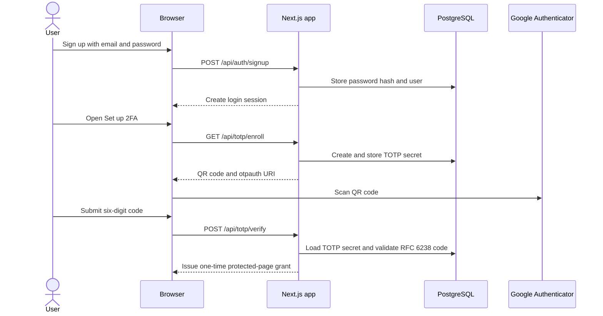

# Google Authenticator 2FA flow

The app uses a 20-byte random secret, SHA-1 HMAC, six digits, and 30-second time steps, matching the common Google Authenticator defaults. Codes one time step before or after the current step are accepted to allow for small clock drift.
