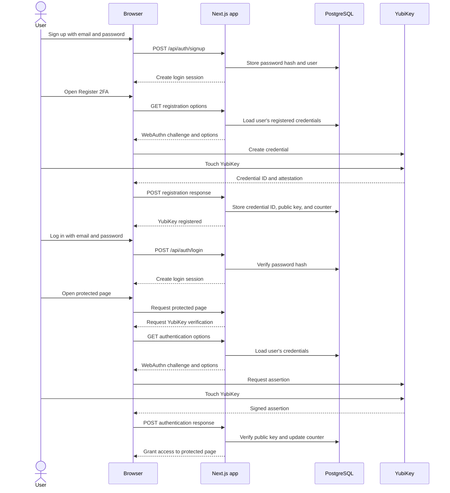

# YubiKey 2FA flow

This diagram shows the application’s password-first login flow and WebAuthn/FIDO2 verification with a YubiKey.



## Stored 2FA data

The application stores the YubiKey credential identifier, public key, signature counter, and supported transports in `webauthn_credentials`. It never stores the private key; that remains protected by the YubiKey.

## WebAuthn payloads

The payloads are JSON representations of WebAuthn options and browser credential responses. Binary values are encoded as Base64URL strings.

### Registration

The server sends registration options to the browser:

```json
{
  "challenge": "server-generated-challenge",
  "rp": { "name": "YubiKey 2FA Demo", "id": "localhost" },
  "user": {
    "id": "user-handle",
    "name": "user@example.com",
    "displayName": "user@example.com"
  },
  "pubKeyCredParams": [{ "type": "public-key", "alg": -7 }],
  "authenticatorSelection": {
    "residentKey": "discouraged",
    "userVerification": "discouraged"
  }
}
```

After the user touches the YubiKey, the browser sends a registration response containing:

```json
{
  "id": "credential-id",
  "rawId": "base64url-credential-id",
  "type": "public-key",
  "response": {
    "clientDataJSON": "base64url-client-data",
    "attestationObject": "base64url-attestation-object",
    "transports": ["usb"]
  }
}
```

### Authentication

The server sends an authentication challenge:

```json
{
  "challenge": "server-generated-challenge",
  "rpId": "localhost",
  "allowCredentials": [
    { "id": "credential-id", "type": "public-key", "transports": ["usb"] }
  ],
  "userVerification": "discouraged"
}
```

After the user touches the YubiKey, the browser sends a signed assertion:

```json
{
  "id": "credential-id",
  "rawId": "base64url-credential-id",
  "type": "public-key",
  "response": {
    "clientDataJSON": "base64url-client-data",
    "authenticatorData": "base64url-authenticator-data",
    "signature": "base64url-signature",
    "userHandle": "base64url-user-handle-or-null"
  }
}
```

The server validates the challenge, origin, relying-party ID, signature, credential public key, and signature counter. The private key never appears in any payload.
